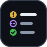
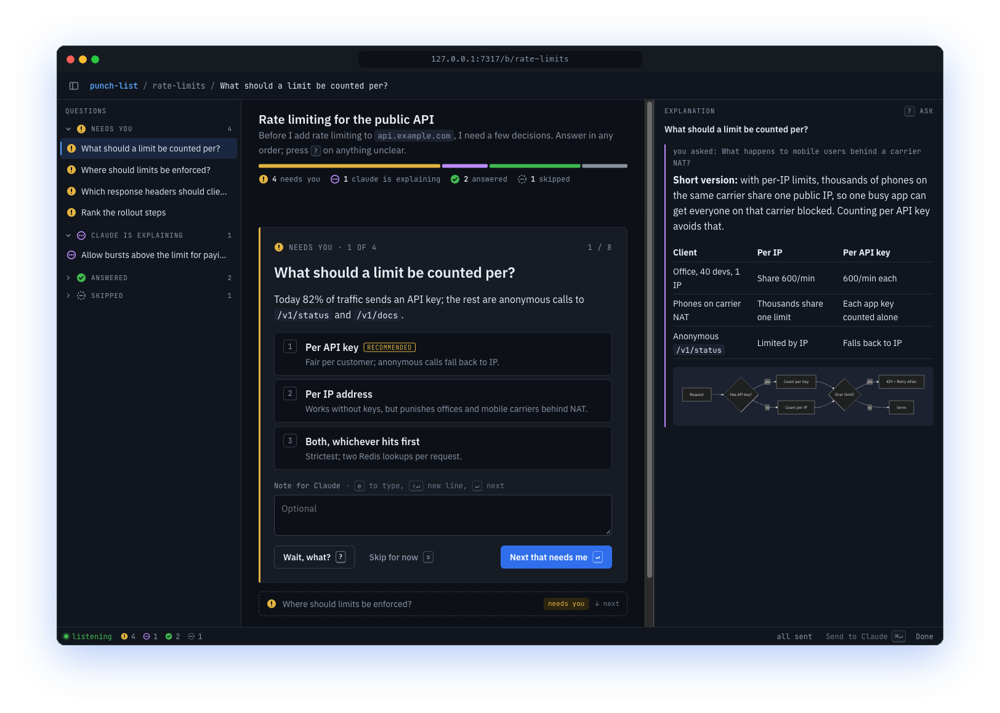
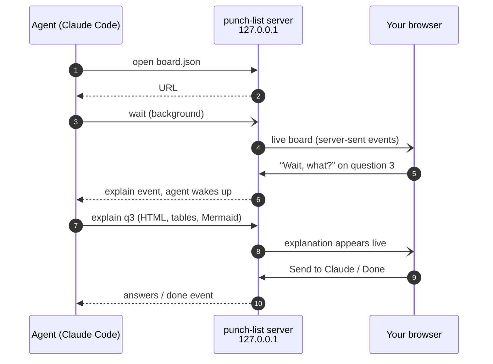

<div align="center">



# sidekick

**Agent skills for working with AI agents without losing your focus.**

[](LICENSE)
[](https://nodejs.org)
[](#install)
[](#how-it-works)
[](#security-and-privacy)

[Install](#install) · [punch-list](#punch-list) · [How it works](#how-it-works) · [Keyboard](#keyboard) · [Board format](#board-format) · [Roadmap](#roadmap)

</div>

---

## punch-list

> Your agent has 14 questions for you. Instead of a wall of text in the terminal, you get a live board: one question at a time, the ones that need you first, and a **“Wait, what?”** button on every single one.

<picture>
  <source media="(prefers-color-scheme: dark)" srcset="docs/assets/framed-dark.png">
  <source media="(prefers-color-scheme: light)" srcset="docs/assets/framed-light.png">
  
</picture>

<sub>The default focus view. Left: every question grouped by what it needs from you. Middle: the current question. Right: the agent's answer to “What happens to mobile users behind a carrier NAT?”, with a table and a diagram.</sub>

### Why

Twenty questions dumped into a terminal drain your focus. One of them is unclear, you stop to ask about it, lose your place, answer the rest, then scroll back to find the one you skipped. `punch-list` turns that into a checklist you can actually work through:

| | |
|---|---|
| **One question at a time** | The questions that need you come first. Answer one and the next slides into focus. |
| **“Wait, what?” on every question** | Ask for a simpler explanation, or ask your own question. Keep going while the agent writes; the answer appears live, with tables, examples and diagrams. |
| **The terminal stays free** | The agent listens in the background. Keep chatting with it while you answer. |
| **Send when you want** | Answers are saved as you type and reach the agent when you press **Send to Claude**. Mark the board **Done** when you're finished. |
| **Follow-ups appear live** | Answer “yes” and the follow-up appears instantly, or the agent pushes new questions as your answers arrive. Edited questions are flagged so you re-check them. |
| **Keyboard-first** | `1`–`9` to pick, `↵` for the next question that needs you, `?` to ask, `⌘↵` to send. |
| **Any layout** | Focus (default), list, tabs, wizard, Jira-like columns, or a fully custom page written by the agent. |
| **Nothing leaves your machine** | Served on `127.0.0.1` with a per-install token. Boards are deleted after 90 days. |

## Install

Requires **Node 20+**. Nothing else: the CLI ships as a committed single-file bundle, so there is no `npm install` step.

<details open>
<summary><b>Claude Code plugin</b> (recommended)</summary>

```text
/plugin marketplace add ValeriyMaslenikov/sidekick
/plugin install sidekick@sidekick
```

Includes the Stop hook that keeps Claude from ending its turn while one of its boards has nobody listening.

</details>

<details>
<summary><b>git clone</b> (edits take effect immediately)</summary>

```bash
git clone https://github.com/ValeriyMaslenikov/sidekick ~/Projects/sidekick
cd ~/Projects/sidekick && node scripts/install-skills.mjs
```

Symlinks each skill into `~/.claude/skills` and `~/.agents/skills`, and adds the Stop hook to `~/.claude/settings.json`. A backup is kept; pass `--no-hook` to skip it.

</details>

<details>
<summary><b>npx skills</b></summary>

```bash
npx skills add ValeriyMaslenikov/sidekick
```

</details>

## Usage

Just ask: *“put your questions on a board”* or *“use punch-list”*. The skill also kicks in on its own when the agent has four or more questions, or a question that needs a diagram to make sense.

The agent opens a board, gives you the link, and keeps working while you answer. Under the hood it uses a small CLI:

```bash
PL="node skills/punch-list/bin/punch-list.mjs"

$PL open rate-limits --file board.json        # create a board, print its URL
$PL wait rate-limits                          # run in the background; exits on each batch of events
$PL explain rate-limits key --file expl.html  # answer a “Wait, what?”
$PL push rate-limits --file follow-ups.json   # add or edit questions live
$PL status rate-limits                        # full snapshot, e.g. after a restart
$PL close rate-limits                         # finish the board from the agent's side
```

## How it works



- **One background server** for every board, started on demand by the CLI. Boards are stored as JSON under `~/.sidekick/boards/`.
- **`wait` is a long poll** the agent runs in the background. Claude Code wakes the agent when it exits, so your terminal is never blocked.
- **Events are durable.** Nothing is lost if the agent restarts or nobody is listening, and the page offers a one-click prompt to make the agent resume.
- **A Stop hook** stops the agent from quietly finishing its turn while one of its boards is open with nobody listening.

## Keyboard

| Key | On the page | Inside a text box |
|---|---|---|
| `1`–`9` | Pick an option | — |
| `↵` | Next question that needs you | Next question that needs you |
| `⇧↵` | — | New line |
| `⌘↵` / `Ctrl↵` | Send answers to Claude | Send answers to Claude |
| `e` | Start typing the answer or note | — |
| `Esc` | — | Leave the text box |
| `?` | Wait, what? (ask Claude) | — |
| `↑` `↓` / `k` `j` | Previous / next question | — |
| `s` | Skip for now | — |
| `⌘B` / `L` | Toggle the question sidebar | — |

## Board format

```json
{
  "title": "Rate limiting for the public API",
  "questions": [
    {
      "id": "key",
      "title": "What should a limit be counted per?",
      "type": "single",
      "body": "<p>82% of traffic sends an API key.</p>",
      "options": [
        { "value": "key", "label": "Per API key", "detail": "Fair per customer.", "recommended": true },
        { "value": "ip", "label": "Per IP address" }
      ]
    },
    { "id": "burst", "title": "Allow bursts for paying plans?", "type": "yes-no", "showIf": { "key": "key" } }
  ]
}
```

Answer types: `yes-no` · `single` · `multi` · `text` · `number` · `scale` · `rank` · `custom`. Every question can carry free HTML (tables, CDN libraries, `<pre class="mermaid">` diagrams), and every answer can carry a note.

Full reference: [`skills/punch-list/reference/board-format.md`](skills/punch-list/reference/board-format.md).

## Security and privacy

- The server binds to **`127.0.0.1` only**, never to your network.
- Every request needs a **random per-install token** (`~/.sidekick/token`, mode `0600`), so other websites in your browser can't read or write your boards.
- Board ids are validated, so they can't escape the boards folder.
- Boards are deleted **90 days** after they were opened. Change `retentionDays` in `~/.sidekick/config.json`.
- Agent-written HTML runs as-is on the page. That's by design: it's your own local agent, and sandboxing would rule out rich layouts.

## Agent support

| Agent | Status |
|---|---|
| Claude Code | ✅ Full: background `wait`, Stop hook, plugin install |
| Codex, Cursor, others with a shell | ⚠️ Works through the same CLI, but `wait` blocks the chat. Use `wait --timeout 0` at natural pauses. |

## Roadmap

- [ ] Notifications: a count in the tab title and an optional desktop alert when the agent explains or adds a question
- [ ] `punch-list ask`: one-line questions without writing JSON
- [ ] “Accept all recommended” in one click
- [ ] Mini chat: reply to an explanation as a short thread
- [ ] Browser tests for the page in CI
- [ ] Board switcher in the sidebar
- [ ] First-class support for agents without background commands

## Development

```bash
pnpm install
pnpm test     # builds the bundle, then runs the suite
pnpm build    # rebuilds skills/punch-list/bin/punch-list.mjs (commit it)
```

| Path | What lives there |
|---|---|
| `src/punch-list/` | Server, store, CLI (TypeScript) |
| `src/punch-list/page/` | The board page: plain HTML/CSS/JS, no build step |
| `skills/punch-list/` | The skill: `SKILL.md`, reference, bundled CLI |
| `prototypes/focus-view/` | The design prototypes the focus view grew out of |
| `CONTEXT.md` | Vocabulary: Board, Question, Answer, Explain request, Listener… |

## License

[MIT](LICENSE) © Valerii Maslenykov
